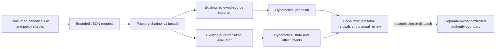

# Versioned shadow consumer

The private root package exposes only
`@clanker-foundry/orchestration/shadow/v1` on Node 24 or later. It reuses the
existing [contract parser](../runtime/src/contract.mjs),
[source importer](../runtime/src/import-export.mjs) and
[pure evaluator](../runtime/src/state.mjs). There is one implementation of their
semantics. No store, runner, provider, isolation host or CLI is packaged/exported.

This is an in-memory inspection boundary, not an operating scheduler. Package
exports limit the supported API; they are not a security sandbox. Existing manual
claims, namespace decisions and Project Memory evidence retain their authority.



## Consumer pin and package boundary

Use an explicitly reviewed full producer commit or integrity-checked packed
artifact, not a moving branch. For example, replace `FULL_REVIEWED_COMMIT` before
using `git+https://github.com/spik3r/clanker-foundry.git#FULL_REVIEWED_COMMIT` as
the consumer dependency. Commit and review the consumer's own lockfile; retain
the producer revision and package integrity in its review evidence. Disable
install scripts. No registry publication is part of this change.

The root lock uses the same pinned AJV dependency graph as the runtime. The pack
allowlist retains only the facade, existing pure modules, their four schemas,
the unchanged Project Memory state helper at its original relative path, and
this guide. npm also includes the existing public README and package metadata.
It excludes task records, source/event history, databases, credentials, operational
modules and tests. The clean-consumer test checks the actual packed inventory,
not only the manifest, and installs the tarball outside the source checkout.

Do not copy or synchronize the helper into a consumer. Consumers may have a
different helper revision or a narrower identity policy. They retain their
canonical Git validation, current claims, unresolved security gates and private
records. Feed the shared facade only the explicitly selected compatible source
shape. A shape mismatch is a refusal, not permission to rewrite history.

## API v1

The module exports `SHADOW_API_VERSION`, frozen `SHADOW_LIMITS`,
`previewReviewedTask(text)` and `previewTransition(text)`. There is no default
export or package-root entrypoint. Operational/deep subpaths and `/shadow/v2`
are unsupported. Importing the module performs no task work or external effects.

Both functions take JSON **text**, bounded to 1 MiB and depth 64 by the existing
strict parser. Duplicate keys, unsafe keys and non-JSON inputs are rejected
before recursive canonicalization. The request must be an object with exactly
the named keys and integer `version: 1`. Unknown fields and versions refuse.

Every successful result has this envelope:

```json
{
  "schema": "clanker-foundry/shadow-preview",
  "version": 1,
  "mode": "shadow-only",
  "authority": "none",
  "kind": "reviewed-task",
  "value": {}
}
```

`value` above is schematic, not a valid generated proposal. Neither success nor
a digest authenticates the caller, source repository, live claim or supplied
context. Functions do not write, fetch, log, acquire ownership, admit tasks or
dispatch returned intents. Inputs remain unchanged; failures preserve the
underlying parser/importer/evaluator error codes. Facade shape failures use
`INVALID_SHADOW_REQUEST` without embedding source text in the message.

### Reviewed source

`previewReviewedTask` requires these keys:

- `version`
- `source`: the existing genuine Project Memory source snapshot
- `spec`: the existing versioned `TaskSpec`
- `reviewedBy`, `expectedRepository`, `expectedRevision`: explicit review pins

The result has `kind: reviewed-task` and the unchanged importer's inert proposal
in `value`. Exactly one genuine source claim is required. Never fabricate a
claim, strip competing claims or manufacture a source to pass inspection. The
proposal binds source pins/claim digest but does not return the source record text.

Importer success checks shape and source correspondence, **not full admission
semantics**. It is not a backlog-inventory check. Run the shared transition
preview separately when inspecting admission guards; do not reimplement those
guards in a consumer.

### Transition inspection

`previewTransition` requires `version`, `current`, `command` and `context`.
`current` is null for ADMIT or an existing `TaskExecution`; `command` is the
existing strict `Command` contract. All time/identity inputs are supplied; no
clock or ID is generated. The facade delegates directly to `evaluate` and
returns its `{execution, event, effects}` under `value`, with `kind: transition`
and the existing `evaluator_version` beside it.

`context` requires `actor_id` and `role`. Its optional boolean assertions are
`references_valid`, `dependencies_satisfied`, `resources_available`,
`worker_eligible`, `namespace_managed`, `can_write` and `isolation_verified`.
Optional `approver_ids` and `trusted_checks` are bounded to 256 entries. A trusted
check entry has exactly `check_id`, `check_version` and `runner_id`. Context
identifiers are nonempty strings of at most 128 characters. The existing
evaluator, not this structural envelope, decides role and transition guards.

These assertions are **hypothetical caller inputs**, not authenticated facts.
A simulated PENDING state is not admission, a reservation, conflict-free scope,
authorization or execution readiness. Two overlapping specifications can both
simulate ADMIT: actual reservations are an assignment/store concern. Effect
intents such as LAUNCH_ATTEMPT are data only; this package has no dispatcher.

When comparing a source preview and transition, the consumer must keep the
same reviewed TaskSpec and exact source/code pins. The two functions deliberately
do not maintain a hidden session, durable state or implied chain of authority.

## Fail-closed consumer adapter

A thin adapter owns repository-specific identity, Git pin inspection, lifecycle,
canonical claim selection, external policies and review presentation. It must
not claim generic Foundry runtime validation from a skipped/rejected record.

Unknown or invalid records with unbounded scope remain inventory uncertainty.
Do not catch a malformed TaskSpec and silently remove that record from conflict
reasoning. Preserve all existing unknown-scope, dependency, ownership and security
refusals. An empty result never means no blockers. Foundry currently has no batch
backlog-inventory model; this surface does not pretend otherwise or replace those
consumer safety checks. A future shared inventory model needs its own reviewed
typed contract and parity tests before duplicated generic code can be retired.

Keep private task inputs and full results within the authorized consumer context.
Do not commit them to this public producer, package them, print them in CI or
use them as public fixtures. Synthetic source records in tests are invented.
Keep caught parser/importer/evaluator messages and details private as well:
upstream errors can contain caller-controlled keys or source paths. A generic
facade-shape error does not make every underlying failure safe to log.
No namespace cutover, helper migration, live provider, persistent access or
consumer activation is authorized by a package install or a shadow result.

## Validation and traceability

Run `node --test runtime/test/consumer-shadow-v1.test.mjs` after installing the
runtime's pinned dependencies. The clean consumer uses npm's populated cache in
offline mode; use the same npm cache as the dependency installation. Run the
complete runtime and Project Memory suites, pack validator and committed
lifecycle gate before final source handoff. Hosted CI remains separate.

| Invariant | Executable source | Focused evidence |
| --- | --- | --- |
| JSON-only bounded intake | `parseJSON` through facade request boundary | duplicate, oversized and deep input regression |
| Genuine source and unchanged provenance | `importReviewedTask` | claim, identity and pin refusal parity |
| One lifecycle implementation | `evaluate` | direct/facade admission, assignment and refusal parity |
| No new authority | facade envelope and absent operational modules | shadow labels, packed inventory, import-effect probes |
| Portable dependency closure | root exact file allowlist and lock | isolated tarball install and supported-subpath checks |

### Gradual machine-checkable modeling direction

The diagram above is an explanatory view, not a new source of truth. More
diagrams alone do not create determinism. The next separately claimed modeling
slice should add a versioned machine-readable transition/guard trace manifest
linked to exact schema definitions, evaluator command cases and named tests.
Generate a state diagram and sequence views from that manifest, and have CI
reject unknown/unmapped states, command IDs, required guard tests and stale views.
Keep a small set of executable traces (input, expected state/effects/refusal)
that replay through the **same** evaluator, not a second diagram interpreter.

An initial trace should show ADMIT as simulated PENDING, then ASSIGN blocked by
unknown scope/resources, with no real dispatch. Include cancellation, cleanup
and fencing traces before expanding the model. Requirement IDs should trace to
contracts, transition guards, fixtures and observed test evidence in both directions.

Later UML/SysML-style structure and requirement views or BPMN-style workflow
views can be projections of that reviewed executable model. BPMN timers,
fork/join and error semantics require explicit mappings and conformance tests
before they may drive execution. This work makes no UML, SysML, BPMN or fUML
conformance claim and introduces no such engine. The existing versioned schemas,
evaluator and tests remain authoritative until a separate reviewed design
deliberately changes that boundary.
