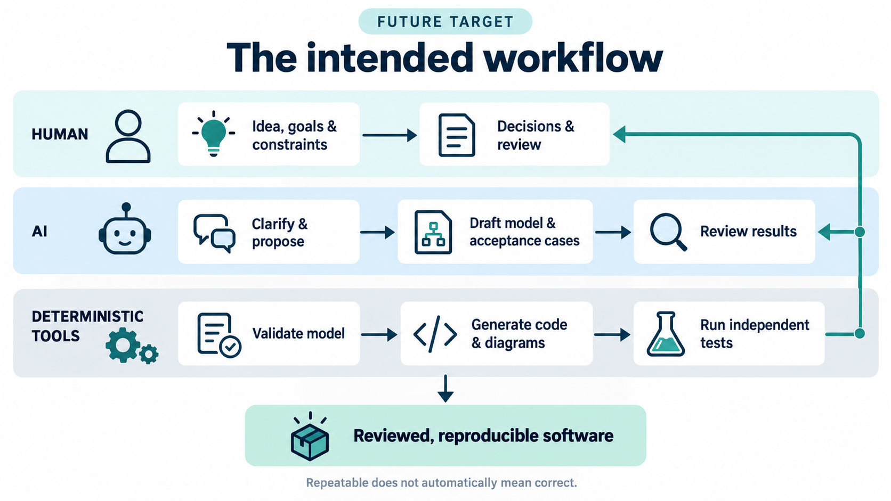

# Clanker Foundry: from an idea to checked software

**People decide what the software should do. AI helps make that design explicit.
Ordinary programs turn supported designs into code and diagrams. Independent
checks test whether the result does what was intended.**

This guide describes the bounded tools in [main at `7d248947`](https://github.com/spik3r/clanker-foundry/commit/7d248947b6b367950988dcc88274358830719c0f),
reviewed on 11 November 2026. They do not turn an arbitrary idea into a finished
application. The [current workflow guide](model-driven-current-workflow.md) has
the supported commands and their review and execution boundaries.

## Who does what?

| Responsibility | People and AI | Deterministic tools |
|---|---|---|
| **Decide the behavior** | People supply goals, constraints and policy choices; AI helps ask questions and find gaps. | Cannot decide what the user wants or whether a policy is appropriate. |
| **Describe the design** | AI or a person drafts a model; people review its meaning and unresolved choices. | Check the supported format, types, references and rules. |
| **Produce implementation** | AI can write surrounding application code, or a separately reviewed candidate from a model. | Existing generators translate supported model constructs into code and views. |
| **Check the result** | Expected outcomes are authored and independently reviewed against the requirements. | Run checks, compare actual results with those expectations and flag stale bindings. |
| **Accept and integrate** | People review the evidence and authorize the next step. | A passing report does not grant approval or deployment authority. |

AI can invoke the programs, but the programs do not ask an AI how to parse a
model, evaluate a guard or generate a supported transition. AI drafting is not
deterministic. AI-written test cases are proposals until their expectations have
been checked independently of the implementation.



The image summarizes the intended division of work, not a fully connected service
available today. Independent checks and human authorization remain necessary.

## What is the model, exactly?

Here, **model means a software design written as structured data**, not the AI
language model. The current lifecycle input is a UTF-8 JSON file with the format
`lifecycle-json/v1` and semantic profile `lifecycle/v1`. The profile defines the
small set of meanings the tools support.

A lifecycle model contains:

- **States and an initial state:** where a task can be, such as `Draft` or `Ready`.
- **Requirements:** identified statements of intended behavior, written for review.
- **Guards:** executable conditions linked to requirements, such as a nonblank actor.
- **Transitions:** a source state, command, destination, required guards and ordered
  effects such as setting the state and increasing the revision.

Requirement text is not executable prose. A requirement only affects the generated
behavior through the supported guards and effects that express it. Review must
check that those rules really capture the intended requirement.

The profile uses a fixed task/command/review data shape and a small vocabulary:
`eq`, `ne`, `nonempty`, `absent`, `all` and `any`, plus three allowed effects.
It cannot describe arbitrary application fields, UI, database queries or API calls.
An editor schema helps with JSON authoring; Go semantic validation remains
authoritative. See the [lifecycle profile and limits](../modeling/lifecycle/README.md).

### A complete small example

The existing [FirstDesignDraft model](../skills/model-driven-design/examples/model.json)
expresses this fictional rule: **submit a draft only when it has a named actor,
an outcome, at least one acceptance criterion and the current expected revision.**

```text
                    submit
Draft ───────────────────────────────────> Ready (terminal)
       all four guards pass:
       actor + outcome + criteria + revision

       any guard fails: keep the original task
```

This is the same complete model, with more compact formatting:

```json
{
  "formatVersion": "lifecycle-json/v1",
  "profileVersion": "lifecycle/v1",
  "id": "FirstDesignDraft",
  "initial": "Draft",
  "states": [
    {"id": "Draft", "label": "Draft", "terminal": false},
    {"id": "Ready", "label": "Ready", "terminal": true}
  ],
  "requirements": [
    {"id": "R_actor", "text": "Submission actor is nonblank."},
    {"id": "R_criteria", "text": "At least one acceptance criterion is supplied."},
    {"id": "R_outcome", "text": "The proposed outcome is nonblank."},
    {"id": "R_revision", "text": "The command names the exact current revision."}
  ],
  "guards": [
    {"id": "G_actor", "requirement": "R_actor", "expr": {
      "op": "nonempty", "args": [{"ref": "command.actor"}]}},
    {"id": "G_criteria", "requirement": "R_criteria", "expr": {
      "op": "nonempty", "args": [{"ref": "task.acceptance"}]}},
    {"id": "G_outcome", "requirement": "R_outcome", "expr": {
      "op": "nonempty", "args": [{"ref": "task.outcome"}]}},
    {"id": "G_revision", "requirement": "R_revision", "expr": {
      "op": "eq", "args": [
        {"ref": "task.revision"}, {"ref": "command.expectedRevision"}]}}
  ],
  "transitions": [{
    "id": "T_submit", "from": "Draft", "trigger": "submit", "to": "Ready",
    "guards": ["G_actor", "G_criteria", "G_outcome", "G_revision"],
    "effects": [{"op": "set_state"}, {"op": "increment_revision"}]
  }]
}
```

`T_submit` says which move is allowed; its guards say when; its effects say what
changes. `set_state` uses the transition's `to` value. This example does not assign
an owner or authenticate the actor. `Ready` is terminal in this two-state example;
the larger lifecycle demo gives it outgoing transitions instead.

### How that JSON becomes executable behavior

**The model already describes a state machine.** A fixed compiler translates that
description into executable state-machine code; it does not invent the rules.
The model is input to the generator, not a program that becomes a new generator.

```text
Reviewed JSON model                         [design as data]
        |
Strict JSON decoder + semantic validation   [ordinary Go code]
        |
Typed, normalized model in memory (IR)       [same design, structured Go values]
        |                         |
Fixed Go compiler             View renderers
        |                         |
Transition(task, command)     State SVG, decision table, trace
+ derived structural tests
```

1. **Decode and validate.** The JSON adapter rejects malformed or unsupported
   input and builds a typed intermediate representation (IR). Semantic checks
   reject mistakes such as a missing target state, unknown guard, wrong operand
   type or two transitions for the same state and command.
2. **Normalize the accepted design.** Supported unordered collections get a stable
   order; ordered effects retain theirs. JSON is one file format for this IR, not
   its definition. No general-purpose format importer is included.
3. **Generate code and views.** The compiler emits Go guard functions, state/command
   branches and effects. For `T_submit`, it tests all four guards and, on success,
   copies the task, sets `State` to `Ready` and increments `Revision` once. The
   generated package exposes `Transition(Task, Command) Result`. View renderers
   project the same IR; trace hashes bind output files to model/build identities.
4. **Compile, exercise and review separately.** Emitting code does not run it.
   Execute reviewed code only within the authorized workflow, then compare it
   with independent expectations. Application integration is a further step.

The generated function accepts typed Go values, not raw JSON requests. Its fixed
runtime also checks input bounds and revision overflow; modeled guards are not the
only possible refusals. It returns a result and a task copy, without persistence,
network calls, worker dispatch or real review authority.

For example, start with a valid `Draft` task at revision `0`, a nonblank outcome,
one criterion and no owner. Submit with actor `author-1` and expected revision `0`:

| Change to that input | Expected result |
|---|---|
| None | Accepted: a new task in `Ready` at revision `1`; content and owner preserved. |
| Actor is whitespace | Refused with `G_actor`; task unchanged. |
| Acceptance list is empty | Refused with `G_criteria`; task unchanged. |
| Expected revision is `1` instead | Refused with `G_revision`; task unchanged. |
| Task is already `Ready` | Refused with `ILLEGAL_TRANSITION`; task unchanged. |

The [separate literal scenario suite](../skills/model-driven-design/examples/suite.json)
contains these kinds of accepted and refused cases. A test passes when the actual
result matches its expectation, including an expected refusal. Do not replace a
failing expectation with whatever the implementation happened to return.

For source-level detail, follow the [JSON adapter](../modeling/lifecycle/jsonformat/json.go),
[typed IR and validator](../modeling/lifecycle/model/ir.go) and
[Go compiler](../modeling/lifecycle/compiler/generate.go). The fixed `modelc` demo
reads its own `examples/lifecycle.json`; it does not accept arbitrary input paths.
Use the current workflow guide for the five-file FirstDesignDraft proposal above.

## Two ways to implement a reviewed design

**Deterministic generation:** an existing compiler implements the constructs its
profile supports. The lifecycle generator produces the small Go transition
function above. A separate [JSON validator generator](../modeling/jsonvalidator/README.md)
uses `json-boolean/v1` to emit Go and TypeScript boolean predicates for already-parsed
JSON values. For example, its sample requires a string `id` and `enabled: true`:
`{"id":"task-1","enabled":true}` passes, while the same input with `enabled: false`
fails. That profile is separate from the lifecycle model and its authoring schema;
it is not a general JSON Schema implementation or an application generator.

**Agent-written implementation:** a reviewed model can instead be a blueprint for
an AI builder to write code, followed by independent source review and checks.
The [Go builder exercise](../examples/model-builder-go/README.md) and its
[admitted trial](../examples/model-builder-go/admitted-run/evidence.md) demonstrate
this route for one fictional pure function. That writing step is AI work, not
fixed generation, and the trial does not establish general reliability or a
maintained consumer feature.

Neither route generates an entire application. Engineers still need to handle
whatever lies outside the chosen profile, such as storage, authentication, APIs,
UI and integration, with their own requirements and tests.

## Why keep the design separate from code?

Think of building a bookshelf. The requested space and load are the requirements.
A measured cutting-and-assembly plan is the model. A programmed cutter is the
generator. The cut parts are generated code; builders still assemble the shelf.
An independent inspector checks it against the original space and load, not just
against the cutter's output.

```text
Customer's needs -> reviewed plan -> programmed cutter -> parts + assembly
        |                                                       |
        +---------------- independent fit/load checks -----------+
```

One plan can also produce a parts list and an assembly picture, just as one model
can produce code and views. But a perfectly repeatable cutter makes the wrong
shelf if the plan has the wrong width.

**Determinism gives reproducibility, not correctness.** The same accepted model
and pinned generator/toolchain should produce the same bytes. A wrong rule or a
generator bug can be repeated perfectly. Derived tests may share the same mistake,
so independently stated expectations and review remain essential.

Changing a requirement means reviewing the model, regenerating affected outputs
and checking expectations again. Source hashes identify exact bytes; canonical
model digests identify normalized design content. Binding and comparison tools
can flag stale evidence and declared changes, but they do not prove provenance,
behavioral equivalence or approval. The [revision tutorial](../modeling/lifecycle/tutorial/README.md)
shows this with a change that starts refusing a blank actor.

## What exists now, and what is still the goal?

**Implemented, within bounded profiles:** model decoding and validation; lifecycle
Go generation and views; separate Go/TypeScript JSON predicates; preparation,
comparison and replay tools; and a fictional agent-written Go exercise. These are
building blocks and examples, with separate review and execution steps.

**Still to establish:** a real consumer's accepted feature, its surrounding
application integration, independent operator repeatability and evidence that the
extra modeling work is worthwhile. The [current direction](current-direction.md)
defines those consumer gates. A green fictional replay does not close them.

The ideal outcome is **working software with a versioned account of what it should
do, why it behaves that way and what was actually checked**. Reduced drift, clearer
review, lower cost and fewer defects are reasons to test the approach, not measured
benefits promised by the current tools.

The lifecycle profile and views claim no UML, SysML, BPMN, UTP or fUML conformance.
Those standards offer useful concepts, but adopting one would require an explicit
subset, semantic mapping and separate conformance checks.

Skills, Project Memory and the optional orchestration runtime help organize the
engineering work around this pipeline. They are separate components, not generated
outputs or automatically connected stages. Start with the
[current workflow guide](model-driven-current-workflow.md) to try the supported
modeling path, or return to the [four core parts](../README.md#four-core-parts).
