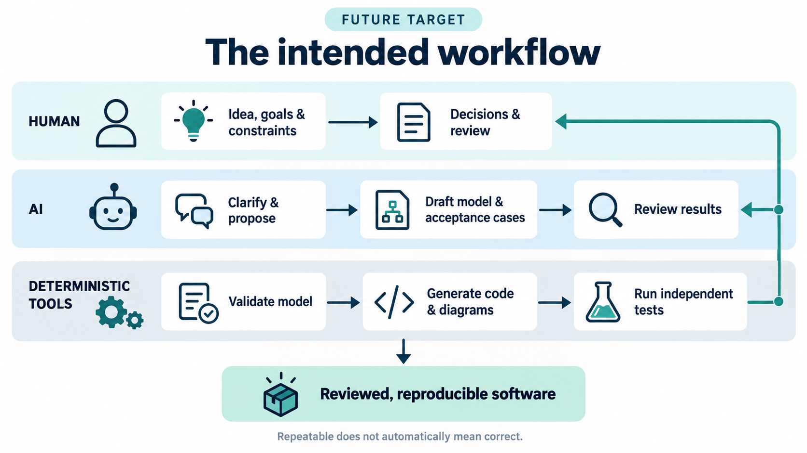

# Clanker Foundry: from an idea to checked software

**The idea:** people and AI work out what software should do; a reviewed,
structured design makes the rules explicit; repeatable tools turn those rules
into code and diagrams; independent tests check whether the result does what
was intended.

This is the direction we are building toward, not a claim that Foundry can
already turn any idea into a finished app. A small task-lifecycle example works
today. The broader pipeline still needs integration and review.

## What would the ideal finished experience look like?

A person describes the outcome, constraints and examples of success or failure.
AI helps turn that brief into explicit requirements and a proposed design, asking
about gaps rather than silently deciding. People review the meaning. Tools then
produce the supported code and views and run checks against independently stated
expectations. People review the evidence and authorize integration or ask for
changes.

The ideal result is **working software with an understandable, versioned account
of what it should do, why it behaves that way and what was actually checked**.
Changing a requirement should reveal which rules, outputs and evidence need
attention, instead of leaving code, diagrams and old approvals out of step.
This is the intended end state, not functionality fully delivered today, and not
a promise to generate every part of an application without engineering work.

## Why try this approach?

A request like "finish a task only after review" leaves questions: who may
review, what exactly was reviewed, and does that review survive a later edit?
Putting an explicit model between the conversation and code is intended to:

- **Expose assumptions early:** review a rule before it is buried in code.
- **Reduce drift:** derive code and explanatory views from the same accepted rules.
- **Make changes easier to inspect:** retain versions and show which evidence is
  stale, rather than treating an earlier pass as valid forever.
- **Use AI where judgment helps:** exploring and drafting, while fixed programs
  handle repeatable translation and comparisons.
- **Make errors easier to challenge:** compare results with independent
  expectations instead of letting generated code define its own success.

These are reasons to test the approach, not measured claims of lower cost, fewer
bugs or faster delivery. Modeling also adds work and deliberately limits what the
current tools can express.

## The few concepts to know

| Concept | Plain meaning |
|---|---|
| **Intent and requirements** | The outcome we want and concrete conditions it must meet. Questions and trade-offs stay visible. |
| **Model** | A precise design written as data. In today's example it lists states, allowed moves, conditions and effects. This is not the AI language model. |
| **Semantic profile and validation** | The small set of rules the tools understand, plus checks that the design uses them consistently. For example, a transition cannot point at a nonexistent state. A valid design can still be the wrong design. |
| **Generator** | A program that translates an accepted model into code and other files. Today's implementation target is a small Go transition function, not an entire app. |
| **Views and traceability** | Diagrams, tables and links that help people follow requirements through model elements and tests. A link explains a connection; it does not prove the requirement is met. |
| **Independent acceptance tests** | Examples of what must succeed or be refused, with expected results written from the requirements rather than copied from generated code or a test run. |
| **Version binding and change impact** | Record which model and files evidence refers to. When they change, flag stale evidence and show declared connections for review rather than quietly reusing an old approval. |

Internally, the generator uses a **typed intermediate representation (IR)**: the
model's meaning separated from its file format. JSON is the current input format,
not the long-term definition of the design language. Any future format adapter
must preserve the supported meaning or reject what it cannot represent.

## Who does what?



The rows summarize responsibilities, not every execution step or approval gate.
The final reviewed result requires independent checks and human authorization,
not just generation. This is a future target, not a fully connected service
available today.

**Human input** supplies goals, constraints, real examples and choices.
**AI work** helps clarify and draft requirements, models, tests and
surrounding code; its output remains a proposal. **Work outside AI** uses ordinary
programs to validate the supported model, generate artifacts, compare test results
and detect stale evidence. AI may invoke those tools, but does not replace their
algorithms or decide that a failing check passed.

AI-drafted acceptance cases are proposals, not independent evidence by themselves.
Their expected results need independent checking against the requirements, not
copying from the generator's output. Humans remain responsible for reviewing the
meaning and making the authorization decisions.

## The end-to-end goal

The lower integration step is a goal, not a capability supplied by the current
lifecycle demo. The two testing paths are deliberately separate:

```text
Human intent + decisions (AI helps clarify and draft)
                         |
                 Reviewed requirements
                    /               \
                   v                 v
          Reviewed model       Independent expected results
                   |                 |  (from requirements)
          Validate + generate        |
                   |                 |
       Code, views, structural tests |
                   |                 |
                   +--------+--------+
                            v
                 Run checks + independent review
                            |
             Explicit authorization to integrate
                            |
             Goal: usable software + review evidence
                            |
                Feedback -> revise and check again
```

Humans own the intent, trade-offs and authorization. AI can help ask questions,
draft a model, suggest cases, write surrounding code and review changes. Those
suggestions are not automatically accepted. Deterministic tools handle the
bounded translation and comparison steps; they do not decide what the user wants.

**Determinism improves reproducibility, not correctness.** The same accepted
model and pinned generator/toolchain should produce the same bytes. A wrong rule
or a generator bug can be reproduced perfectly. Tests generated from that same
rule may share the mistake, so independent expectations, code review and checks
that deliberately introduce faults remain essential. AI drafting itself is not
claimed to be deterministic.

## An analogy: a workshop building a bookshelf

Imagine saying, "I want a shelf that fits this alcove and holds these books."
The brief is the **idea and requirements**. A measured cutting-and-assembly plan
is the **model**. A programmed cutting machine is the **generator**. Cut parts
are the **generated code**, and the assembled shelf is the **implementation**.
Measuring the finished shelf against the alcove and checking it with the intended
books are **acceptance tests** chosen from the original brief, not from whatever
the cutting machine happened to produce.

```text
Human customer: "Fit this space; hold these books"       [idea]
             |
Human designer + AI drafting assistant
             |
Reviewed dimensions and assembly plan                   [model]
             |
Programmed cutter + fixed settings                      [generator]
             |
Parts -> builders assemble the shelf                    [implementation]
             |
Independent inspector checks fit and intended load      [tests]
             |
Human customer accepts it, or asks for a revision
```

The plan can also produce an assembly picture and parts list: different views of
one design. But a perfectly repeatable cutter still makes the wrong shelf if the
plan has the wrong width. The analogy stops there: software also needs checks for
security, integration and conditions that a small model does not describe.

## What is actually merged today?

This snapshot describes [main at `2c23031f`](https://github.com/spik3r/clanker-foundry/commit/2c23031f6fcfcab267828d072201abce504f613f),
including the lifecycle tutorial, on 1 November 2026. It distinguishes source in
main from local proposals; it is not a deployment or production-readiness claim.

| Merged building block | What it does, and its boundary |
|---|---|
| [Lifecycle model and compiler](../modeling/lifecycle/README.md) | Validates a small, explicit state-machine profile and generates a Go transition function, state SVG, decision table, structural tests and artifact trace. It is an isolated example, not a scheduler. |
| [Authoring schema](../modeling/lifecycle/authoring/README.md) | Helps editors and AI draft the JSON shape. Go semantic validation remains authoritative; a schema pass is not enough. |
| [Design intake](../modeling/lifecycle/intake/README.md) | Records intent, decisions, open questions, declared artifact identities and supplied byte observations. It checks consistency, not model validity, authorship or approval. |
| [Acceptance authoring](../modeling/lifecycle/acceptanceauthor/README.md) and [scenario replay](../modeling/lifecycle/scenarios/README.md) | Bind hand-written literal expectations to a model and compare actual runs with them. They do not rewrite expectations to make failures pass. |
| [Requirements trace](../modeling/lifecycle/traceability/README.md) and [change review](../modeling/lifecycle/impact/README.md) | Expose declared links, coverage gaps and model differences. They do not prove correctness, test execution or behavioral equivalence. |
| [Revision tutorial](../modeling/lifecycle/tutorial/README.md) | Connects existing tools in a disposable copy and demonstrates stale evidence, explicit expectation review and replay after a model revision. It is a worked example, not an automated product workflow. |

The separate [agent skill pack](../README.md) and [orchestration runtime](../runtime/README.md)
help organize engineering work. They are not generated by this lifecycle model;
the demo does not activate workers or replace their authority rules.

**Still outside this merged snapshot:** the full idea-to-product experience,
general model import, production integration and packaged qualification evidence.
Automatic approval is not the goal: authorization remains a separate decision.
Local or unmerged work on an intake/model bridge, review packs, model
patches, qualification/export and downstream handoff is not counted as delivered
here. A separate process-view lane is exploring a BPMN-inspired view; that is not
merged BPMN support. These are directions or proposals, not promises of their
final design.

## A small lifecycle example

A task can move through this invented lifecycle:

```text
Draft -> Ready -> InProgress -> InReview -> Done
                     ^            |
                     +-- rework --+
```

The arrows are not unconditional. Starting requires a named actor compatible
with the owner. Approval requires a distinct reviewer and a review bound to the
current task, revision, task content and model. Rework makes an old review stale.
These are checks on supplied example data, not authentication of real reviewers.

The [tutorial](../modeling/lifecycle/tutorial/README.md) makes one smaller change:
`prepare`, the move from Draft to Ready, initially allows a blank actor; the
revised model requires a nonblank actor. Reviewers state the expected refusal
before running the revised code. Old evidence is flagged as stale, not counted
as a completed test. After review and regeneration in the disposable copy, new
runs must refuse the blank actor while still accepting a named actor. Expected
refusal is a passing test comparison, not a successful state transition.

That is the intended loop in miniature: clarify a rule, change its model, inspect
the consequences, explicitly review the expected outcomes, then rerun the checks.

## Where UML, SysML, BPMN, UTP and fUML fit

These standards offer useful modeling concepts, but they are not interchangeable:

- [UML](https://www.omg.org/uml/) describes software and system structure and
  behavior. A UML-style picture alone does not define an executable application.
- [SysML](https://www.omg.org/spec/SysML/2.0/Language/PDF) models systems, including
  requirements, structure, behavior and verification. Using requirement links
  does not by itself make a tool SysML-conformant.
- [BPMN](https://www.omg.org/bpmn/) describes business processes and their flow.
  A BPMN-inspired picture is not BPMN interchange or a conforming execution engine.
- [UTP](https://www.omg.org/spec/UTP2/2.2), the UML Testing Profile, provides test
  modeling concepts. It does not make expected results independent or correct.
- [fUML](https://www.omg.org/spec/FUML/1.5/PDF) defines execution semantics for a
  specified subset of UML, not arbitrary UML diagrams. Our custom state-machine
  generator is not an fUML implementation.

Today's lifecycle format is a deliberately small custom profile. It claims no
UML, SysML, BPMN, UTP or fUML conformance. Adopting any of them would require an
explicit version and subset, a reviewed semantic mapping, refusal of unsupported
constructs and separate conformance checks. The near-term point is simpler:
**make intent inspectable, translation repeatable, and checking independent.**
